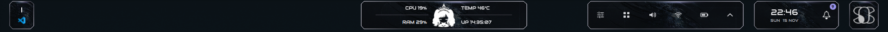
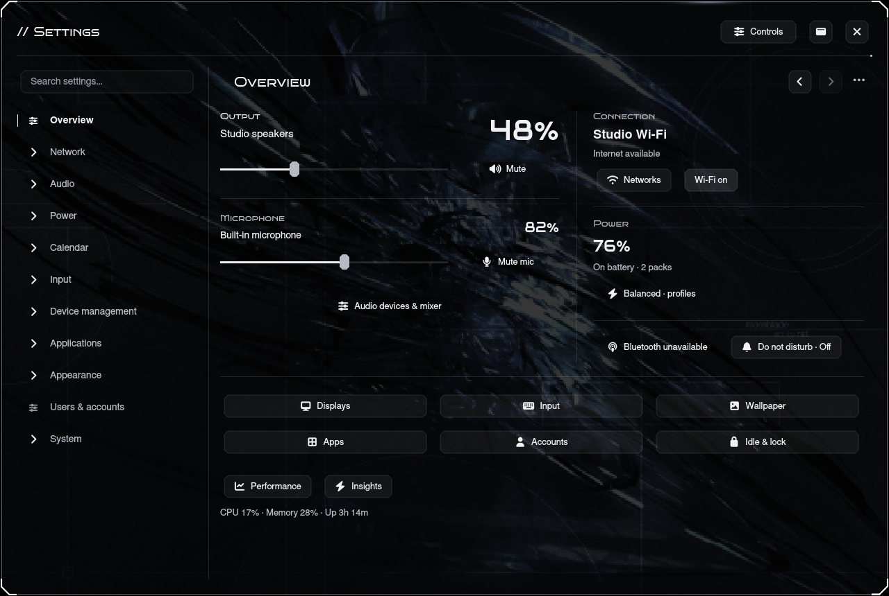
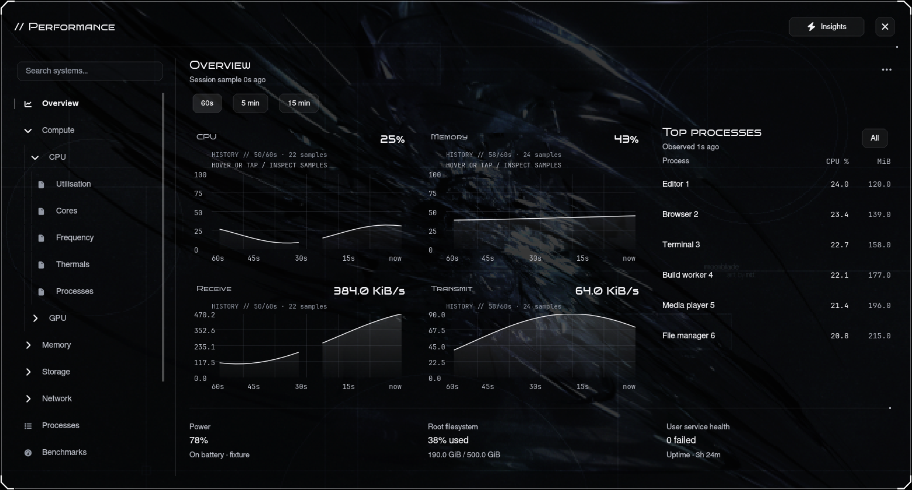
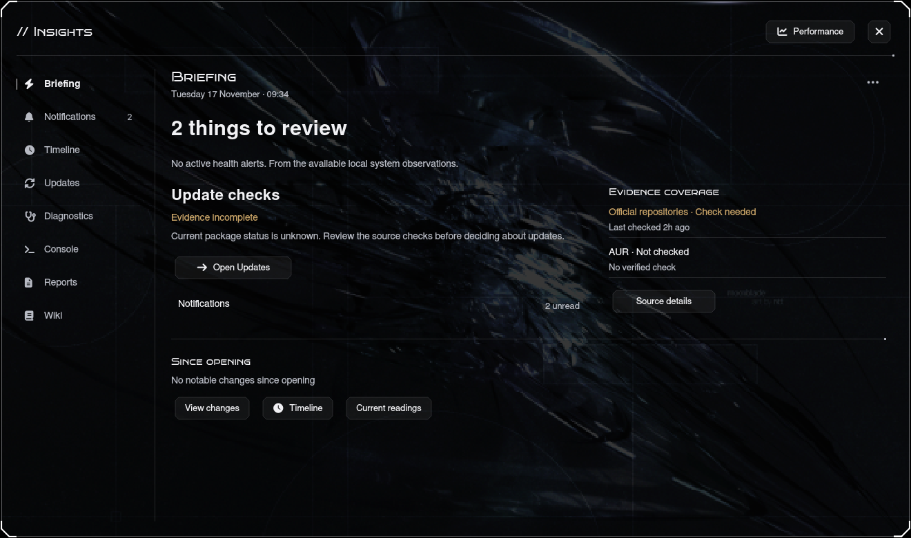
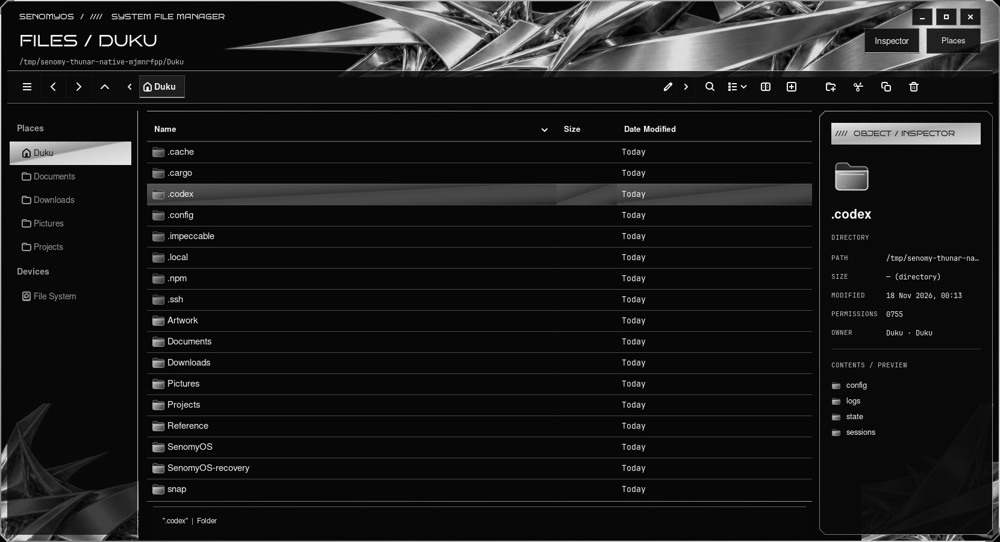
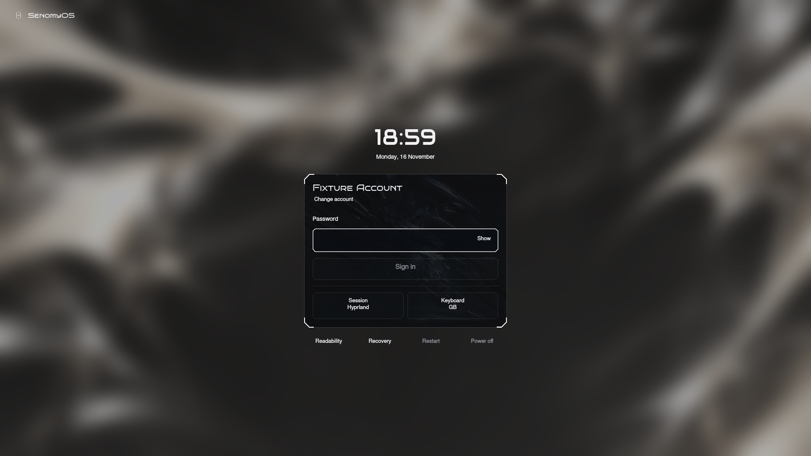

# SenomyOS

My personal desktop project, built on Arch Linux with Hyprland and Quickshell and the help of ChatGPT Codex.

I started this because I wanted a desktop that felt like mine, from the system
bar and settings to the login screen and file manager. The look is dark glass,
silver frames, sharp corners and metalheart-inspired artwork. I'm building the
everyday controls around that, so it feels like one desktop when I use it.

It's a working desktop that I'm still developing. The name is where I want to
take it eventually: a reproducible system with its own setup, updates and
recovery. Right now, this repo is the shell, integrations, themes and the work
towards that.

## What it is now

The shell runs natively in **Quickshell / QML**, with **Hyprland** handling the
Wayland session. Earlier versions used Eww; the current desktop has moved on
from that.

- **Obsidian Rail** — the bottom bar for workspaces, system readings, quick
  controls, notifications, the clock and power.
- **Control Centre and Settings** — quick controls and a full resizable settings
  window, sharing the same pages, search and saved preferences.
- **Performance** — a separate dashboard for CPU, memory, storage, network,
  processes, services and diagnostics.
- **Senomy Insights** — local system briefings, notifications, updates, reports
  and a searchable wiki. I want it to explain what the system actually knows.
- **Command Lens** — a native launcher for apps, files, windows and actions,
  with local app-use sorting.
- **Everyday panels** — audio and media, Wi-Fi, Bluetooth, batteries, calendar,
  notifications, app tray and session controls.
- **Native file manager** — Thunar with a custom GTK3 theme, silver framing,
  Places navigation and an object inspector, keeping its normal file tools.
- **Login and lock** — a custom SDDM greeter and matching Hyprlock styling,
  alongside Plymouth boot artwork.

There's also a persistent local calendar service, on-screen keyboard support,
multi-battery handling, display/workspace management, and deployment tools with
receipts and rollback. Features still depend on the available system providers
and hardware; having the UI in place doesn't mean every device path is finished.

## Screenshots

These are captures of the native interfaces. The Rail is a live desktop capture;
the larger panels, Thunar and SDDM below are native previews with test data.
They show the recent design work without publishing my notifications or files.
The SDDM image is a greeter preview, rather than a real sign-in test.

### Settings

### Performance

### Senomy Insights

### Files

### SDDM login

More captures and design notes are in the
[design library](docs/design/design-intelligence/INDEX.md) and the
[UI/UX atlas](docs/design/uiux-atlas/README.md).
[Screenshot notes](docs/screenshots/README.md) record the gallery sources.

## The plan

I want to keep improving the desktop I use while making it easier to run on
another machine. The next steps are:

1. Keep refining the existing UI: layout, motion, keyboard focus, readability
   and how the panels behave at different sizes.
2. Finish testing real everyday workflows: Bluetooth audio, network recovery,
   external displays, suspend/resume, input settings and battery behaviour.
3. Make installation and updates repeatable, with versioned releases and a
   rollback path that has been tested from a clean environment.
4. Test fresh-user and VM setups, then build up a realistic hardware list.
   My ThinkPad T480 is the reference machine, not the only intended target.
5. Work towards installer and recovery media once the underlying setup is ready.
   Touch and convertible layouts are part of that direction; ARM and smaller
   devices are longer-term experiments.

There isn't a release date yet. Clean installation, recovery, long-running
resource use and wider hardware testing still need work. The
[project state](docs/PROJECT_STATE.md) keeps the detailed progress, known limits
and next work in one place.

## Looking around the repo

| Path | What's in it |
| --- | --- |
| `shell/quickshell/` | Native shell, panels, shared state and service adapters |
| `components/` | Calendar, input, session, launcher and desktop integrations |
| `appearance/` and `assets/` | Themes, artwork, frames, fonts and shared appearance tokens |
| `scripts/` | Checks, diagnostics, deployment and system-action helpers |
| `deploy/` and `systemd/` | Package/service definitions and deployment transactions |
| `hyprland.lua` | Tracked Hyprland configuration |
| `docs/` and `wiki/` | Project documentation, design evidence and user help |

For setup and development, start with the [development guide](docs/DEVELOPMENT.md)
and [deployment guide](deploy/README.md). This is still a personal development
setup, so installation needs a review of the configuration and dependencies.

The other main docs are the [product spec](docs/PRODUCT_SPEC.md),
[architecture](docs/ARCHITECTURE.md), [design system](docs/DESIGN_SYSTEM.md),
[project state](docs/PROJECT_STATE.md) and [working rules](AGENTS.md).
Detailed contracts live in [docs/reference](docs/reference/README.md), and the
[wiki](wiki/welcome.md) covers using the desktop.
