# Analysed visual references

Each anchor matches `catalogue.json`. Image links use curated local evidence;
source/approval paths and fingerprints are in the catalogue/provenance. Estimates
below describe the image, not immutable tokens. Static images establish visual
relationships; linked code/QA supplies interaction claims and their limits.

## A01 — Obsidian Rail: approved direction, historical composition

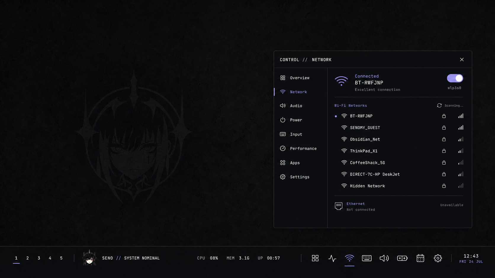

**Authority:** `DESIGN_SYSTEM.md` approves the Obsidian direction. This is concept
art, not a current-runtime screenshot or blanket approval of its navigation.

- **Proportions:** the bottom band is roughly one ninth of the 1672×941 concept;
  the right-side panel spans about two fifths of the image width. These ratios
  explain “persistent compact instruments + contextual reading plane”, not current
  panel dimensions.
- **Hierarchy:** workspace → identity/message → telemetry → controls/clock reads
  as distinct groups. Network's current connection leads its panel; discovery is
  subordinate and wired state sits below a quiet separator.
- **Spatial rhythm/framing:** shared baselines, repeatable row spacing and generous
  group breaks produce coherence with few boxes. The thin panel perimeter and
  structural sidebar rule separate functions without a card around every row.
- **Typography/density:** compact technical labels and aligned right-side status
  support scanning. The concept's all-mono treatment is superseded by current
  DirectoryStyle roles, and should not be imposed on long body text.
- **Interaction model:** selected route/status is visible, but this still proves
  no focus, discovery, toggle or network action. Current native contracts decide.

**Transfer:** group cadence and contextual hierarchy. **Exclude:** its Performance
Control Centre tab, historical workspace underlines, literal network names and
fixed pixel proportions. A04/A05 outrank its Rail artwork/feedback details.

## A02 — Cathedral Deck: approved information architecture

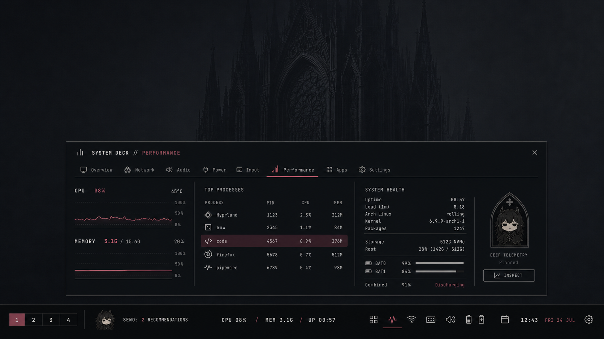

**Authority:** product/design documents approve a separate expanded Performance
surface based on this direction, not its entire visual palette or feature set.

- **Proportions:** a wide, low deck near the Rail; approximately three content
  regions progress from histories to processes to health. Process comparison gets
  a broad middle column rather than a collection of unrelated statistic tiles.
- **Hierarchy:** page identity/navigation precede evidence; CPU/RAM history,
  aligned process columns and system health have distinct reading tasks. Key
  numeric values are stronger than units and supporting labels.
- **Rhythm/framing:** one outer perimeter and sparse vertical/horizontal rules
  align groups. Repeated rows create a scan rhythm; chart baselines and tabular
  numbers make changes comparable. Moderate density is earned by useful evidence.
- **Typography:** short uppercase headings act as landmarks; smaller mono data
  aligns values. Use today's type roles rather than copying concept font pixels.
- **Interaction:** the INSPECT affordance suggests drill-down; actual filtering,
  process review, reports and exports belong to existing QML/service contracts.

**Transfer:** evidence groups, aligned histories/tables, task-specific density.
**Exclude:** garnet as a new theme, portrait inside the health card, Performance
inside a general Control Centre tab bar, fabricated healthy values and arbitrary
shell console access. Those conflict with current explicit product decisions.

## A03 — Illustrator master and original Island construction

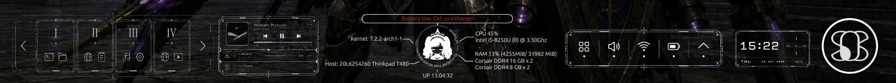

**Authority:** authored-reference; the master is an existing creative source, not
a claim that every element was accepted. The master PDF-compatible page was
rendered and compared with its PNG companion; production SVGs and consumers were
also inspected. The excerpt is cropped from that render; see provenance.

- **Proportions:** repeated tall workspace cells, a wider media block, a central
  circular identity and wider system/clock instruments create a deliberate uneven
  rhythm. Each instrument has its own perimeter; a giant master border would erase
  those separations. The wallpaper is an atmospheric field, not functional text.
- **Hierarchy:** luminous silver structure frames the dark instruments; the
  central circular mark breaks rectangular repetition. Clock numerals are strong.
  Kernel/hardware paragraphs around the medallion compete at small scale and are
  not a model for adding permanent diagnostic prose to the current Rail.
- **Rhythm/framing:** chamfered corners, interrupted rules, fine ticks and fixed
  central motifs carry identity. Stretching the full export would thicken corners
  and distort its emblem. ArtFrame's protected bands and SurfaceOutline's fixed
  corners preserve these relationships as content width changes.
- **Typography/density:** display numerals distinguish clock/value roles from
  technical annotations. Tiny media metadata and near-wallpaper text are useful
  anti-lessons at actual scale; do not copy them merely because they are authored.
- **Interaction:** arrows/playback/icons show intended affordances only. The master
  has no verified keyboard, touch, service or adaptive behavior.

**Transfer:** fixed optical caps, neutral stretch spans, shared line weight,
intentional grouping and a single focal exception. **Exclude:** a 1920px hardcoded
layout, opaque screenshot tracing, baked live labels and tiny diagnostic prose.
The `.ai` stays an editable source; the curated PNG is evidence, never a skin.

## A04 — Current native Rail: implemented user-directed decisions

**Authority:** the 9 November button-feedback record documents user-directed
publication. Approval is scoped to those changes; ordinary full-Rail aesthetic or
hardware acceptance is not inferred from publication.

- **Proportions:** this exact 1920×72 live crop retains the 72px reserve. One active
  workspace is small at left; the centre instrument and right-side groups occupy
  bounded allocations with deliberate open space. Empty workspaces are not invented
  to fill that space. Current counts influence the composition.
- **Hierarchy:** bright workspace/central instrument/clock are anchors. Small
  system icons read as one control group; the Power mark is a distinct terminal
  control. The larger bell and bounded badge remain legible without a divider.
- **Rhythm/framing:** chamfered independent silhouettes and fine neutral rules
  carry continuity; no master enclosing frame. Content stays inside artwork's
  protected regions. Read reserve, allocation and optical silhouette separately.
- **Typography/density:** display values/clock and smaller metadata are distinct;
  capacity is spent on working instruments rather than decorative labels.
- **Interaction:** native source/QA retain real workspace/actions, one coordinator
  and keyboard entry. This still confirms layout; it cannot prove physical hover.
  The publication report explicitly says live pointer-warp probing failed.

**Transfer:** role-specific scale, existing artwork and quiet grouping. Preserve
adaptive rails and current action ownership. A05 governs feedback exceptions.

## A05 — Latest button feedback, including deliberate exceptions

**Authority:** `docs/qa/button-feedback-20261109/REPORT.md`, newest applicable
design-system section and decision record. Earlier 8 November corner cues and
press/selection treatments are superseded in the precise ways recorded there.

- **Proportion/rhythm:** the fine outline sits six logical pixels inside normal
  targets, adapting on small controls. Target allocation and label alignment stay
  fixed; visual feedback adds no jitter or layout motion.
- **Hierarchy/framing:** plain resting buttons inside panels leave content primary.
  One shared centre-out chamfered trace serves hover, genuine selection and keyboard
  focus. A second square box or press wash would duplicate the visual signal.
- **Typography/density:** no extra label or ornamental row is needed to express
  engagement. Preserve readable current/checked state alongside the outline.
- **Interaction/motion:** four traces leave the top/bottom centres and meet at side
  centres; 180ms entry/120ms reverse, reduced-motion immediate. Held feedback settles.
  Workspace selection is brightness only, centre Senomy is exempt, and Power
  brightens its existing frame over 160ms without an inner outline or new clock.

**Transfer:** finite passive feedback and distinct pointer/keyboard semantics.
**Exclude:** applying Power's halo to every control or removing functional input,
calendar, checkbox/radio or drag indicators as “chrome”. The image is an isolated
native result; smooth GPU/physical-pointer acceptance remains separate.

## P01 — Audio: implemented, explicit visual acceptance pending

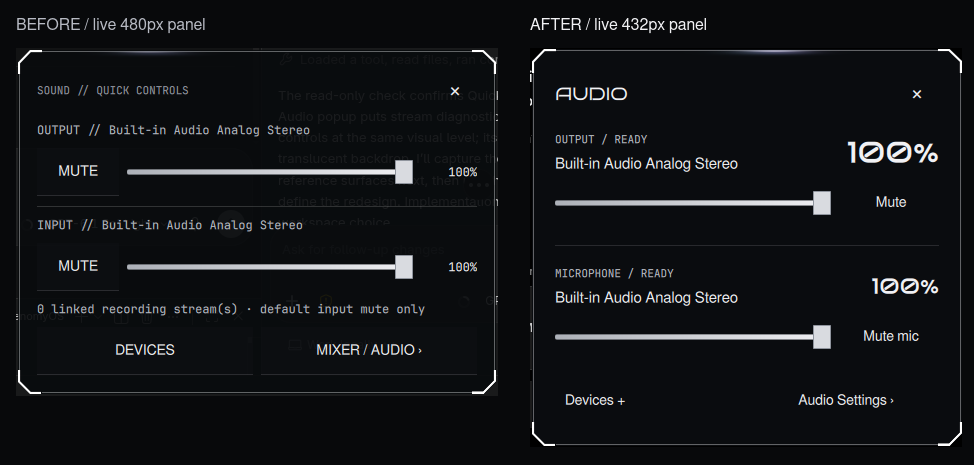

**Authority:** October Audio foundations/review and later refinement, not blanket
user approval. Right side is a published live result from that review epoch.

- **Proportions:** 480×346 before versus 432×399 after; the after has about 4% more
  area. Improvement comes from priority and readability, not simply being smaller.
- **Hierarchy:** endpoint/output gain leads; percentage anchors the right column.
  Microphone stays a separate quieter task; optional devices and full Settings
  are subordinate exits. The two channels are separated by one quiet rule.
- **Rhythm/framing:** an opaque functional ground, one authored perimeter, clear
  inset, aligned labels/sliders and larger inter-group than intra-group gaps.
  Endpoint wrapping is contained within its column rather than crossing the value.
- **Typography/density:** display heading/value, readable endpoint name and technical
  metadata have different jobs. Removed stream diagnostics no longer compete with
  gain/mute; capabilities remain reachable in full Audio Settings.
- **Interaction:** existing slider/mute APIs, exact endpoint selection review,
  pending/observed completion and coordinator ownership are preserved. Subsequent
  refinement removes singleton device-list duplication and keeps 12px Audio metadata.

**Transfer:** task-first hierarchy, opaque reading ground and progressive disclosure.
**Limit:** Audio-only adoption; no permission to change every popup. The baseline
capture predates subsequent shared button cleanup, so A05 governs today's buttons.

## R01 — Rejected Audio traits: bleed and equal-weight stacking

Use the **left half** of the P01 comparison. **Authority:** agent-observed failure
confirmed in the Audio review and replaced in that implementation; user-wide
rejection of every visual trait is not claimed.

The 480px-wide translucent field lets unrelated application sentences pass behind
functional text. Equally strong OUTPUT/INPUT metadata rows, two large MUTE targets
and an always-present recording diagnostic flatten the task hierarchy. Uniform
gaps fail to distinguish endpoint, gain and secondary information. Underlined or
boxed footer actions spend structural contrast without improving reading order.
The frame itself is reusable: no need to reject its authored corners.

**Correction:** opaque reading plane, output-first grouping, strong aligned gain,
subordinate input, optional inventory and existing full Settings escape. Preserve
the microphone mute's true scope; it is not proof all application recording ceased.
**Do not infer:** hardware routing success or universal accessibility from a crop.

## R02 — Historical installed SDDM: fragmented authentication hierarchy

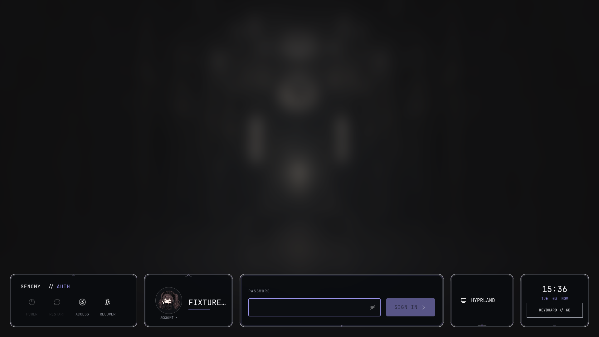

**Authority:** observed critique in `docs/design/REFINEMENT_DIRECTION.md`; a scoped
rejected composition, not proof the current maintained greeter still looks like
this. The later authentication stage is implemented for review, not reinspected here.

Five bottom modules of roughly equal 170px height give utilities, account, password,
session and clock peer importance. The actual login sequence crosses boundaries
from identity into a detached wide credential field. Large empty upper space does
not resolve that fractured reading order. Rounded ornate frames and all-mono
labels differ from current desktop's angular/type-role grammar. Artwork exists;
adding another portrait or logo cannot fix the grouping.

**Transferable correction:** one identity/credential/action composition, secondary
utilities subordinate, narrow order retained. Do not copy the fixed wide-screen
geometry or infer authentication failure from intentionally inert/disabled fixture
controls. This is a historical before-state with fake identity and authentication.

## P02 — Current Settings directory: reuse and inspect critically

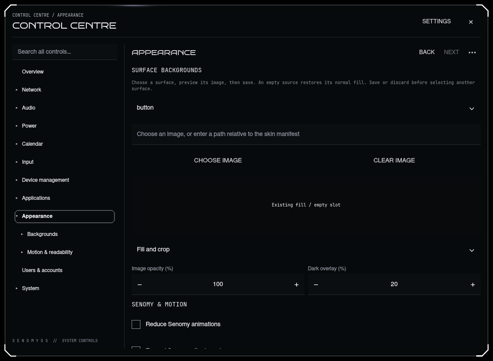
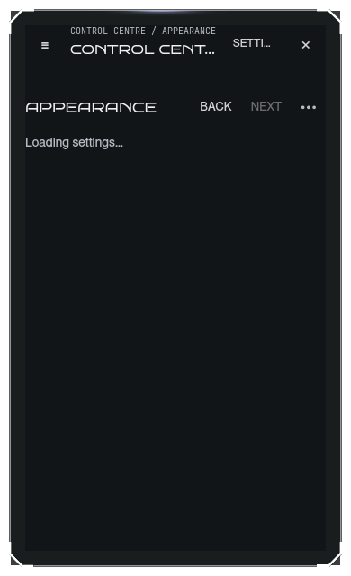

**Authority:** observed current fixture evidence, no whole-screen visual approval.

The wide view allocates about a quarter to navigation and the rest to reading/editing,
with one outer angular perimeter. A search box and indented child routes establish
navigation hierarchy; fields and controls align on a stable content origin. Mixed
heading/body/data roles make it recognizable as today's native system. Quiet resting
buttons and selected inset outlines follow A05.

Critique: repeated CONTROL CENTRE/APPEARANCE labels compete at the top, and the
large preview allocation leaves considerable space between selection and its
adjustments. This is a task to assess, not authorization to compress it now.
The 390px capture truncates header text and shows “Loading settings…”. It is
evidence for frame bounds and a readiness limitation, **not** proof of a complete
narrow Appearance layout. The source report records matching baseline warnings.

Preserve the shared compact/full workspace, nested route/search identity, exact
destination focus, dirty-draft guard, native scroll/focus and work-area bounds.
Borrow navigation continuity from E02 without adding GTK or another coordinator.

## R03 — Explicitly discarded button treatments

**Authority:** 8–9 November user-directed records in the current design system and
`docs/qa/button-feedback-20261109/REPORT.md`. This is a decision anti-reference;
no fabricated “rejected screenshot” has been created.

Competing border/fill/left-marker signals make a small button carry several
equivalent engagement cues. A click wash and separate rectangular focus boundary
conflict with the authored angular outline. Persistent workspace selection boxes
over-emphasize a low-information chip. Continuous moving sheen/scale shifts create
motion without new information and can change apparent target alignment.

These traits are superseded by A05. Do not erase form boundaries or state marks in
the process. Historical intermediate captures can explain a transition, but they
must not silently outrank the current explicit decision.

## E01 — NPS Unigrid: a shared grid without identical compositions

[Primary history and Santa Monica Mountains illustration](https://www.nps.gov/subjects/hfc/a-brief-history-of-the-unigrid.htm).
The published illustration was opened and inspected; primary URL and image digest
are retained in provenance. It is reference-only, not SenomyOS production artwork.

**Visual analysis:** a narrow black identity band anchors one edge while the broad
illustrated field stays continuous. Paired text columns align in a quiet sky region,
avoiding the denser foreground. Scale, cropping and grouped contrast organize many
subjects without equal cards; the grid supports content rather than becoming boxes.
Typography gives identity, heading and explanation separate roles. This print
example establishes no interactive behavior.

**Transfer:** a stable alignment/identity grammar can support different compositions
for briefing, monitoring and operation. **Do not transfer:** palette, typefaces,
illustrations, print dimensions or a poster layout into every functional panel.
This external selection is curator judgment, not SenomyOS owner approval.

## E02 — GNOME adaptive navigation: retain place while changing topology

[Sidebars](https://developer.gnome.org/hig/patterns/nav/sidebars.html) and
[adaptive layout examples](https://gnome.pages.gitlab.gnome.org/libadwaita/doc/main/adaptive-layouts.html).
Published wide and narrow illustrations were visually inspected, including the
narrow detail view with a back affordance. No running interaction was tested.

**Analysis:** the inspected wide sidebar diagram gives navigation roughly a quarter
of its width and preserves one content region. Matching header roles and row
alignment clarify ownership without nested cards. In narrow detail, content occupies
the width and a visible back control retains a way to navigate. Text hierarchy stays
simple; density changes by showing the appropriate region, not by shrinking labels.

**Transfer:** contextual navigation can change topology while preserving route,
selection and return path. Evaluate Senomy's existing drawer/shared routes first.
**Exclude:** rounded GTK chrome, hardcoded GNOME breakpoints and a GTK migration.
Back/focus continuity is a proposed principle supported by the guidance; the stills
alone prove neither actual keyboard behavior nor transition timing.

## E03 — Carbon tables: documentary comparison reference

[Primary table specifications](https://www.carbondesignsystem.com/building-blocks/core/components/data-table/specifications).
Status is **documentary**, since its published image fetch failed (403/timeout).
No screenshot inspection or “exceptional rendered result” is claimed.

The specifications distinguish header/body roles, content-dependent columns,
aligned cells, density options and independent focus/selection states. This is
useful for a specific Performance process-table question. Translate through existing
native table/type roles; do not import React, Carbon tokens, IBM branding or compact
24px interactive targets. Obtain and inspect visual evidence before promoting it
to a visually analysed exemplar. E01/E02 are the inspected external examples.

## A06 — Approved Control Centre split overview direction

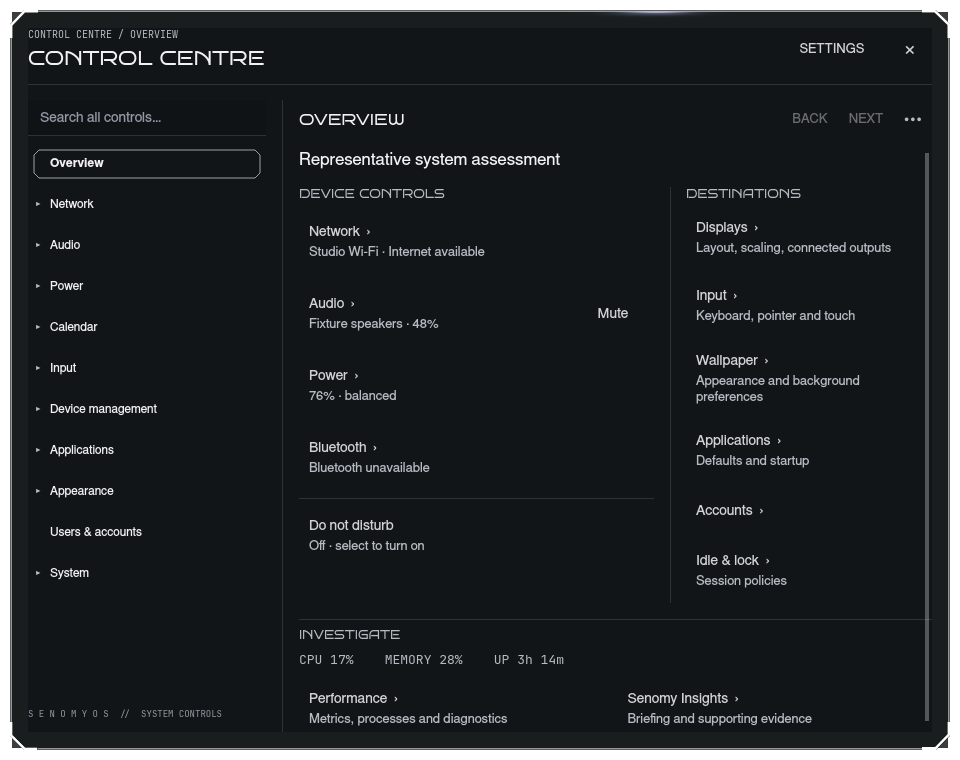

**Authority:** the owner answered “yes i approve” to Control Centre A for the next
implementation stage on 10 November 2026. Exact scope is recorded in
[the approval](../../PROJECT_STATE.md) and the
[implementation review](../../PROJECT_STATE.md). The image
shows the isolated implementation with synthetic providers. The implementation
was subsequently published and separately [verified live](../../PROJECT_STATE.md).
Layout approval does not accept unrelated pages or establish physical/hardware readiness.

- **Proportion/hierarchy:** retain the directory beside a roughly 59:41 split
  of operational controls and curated destinations in the content plane. One
  assessment leads; CPU/memory/uptime and separate investigation exits are quieter.
  Six passive equal tiles and no-player filler no longer dictate the reading order.
- **Rhythm/framing:** natural wrapped rows and 16px group gaps establish hierarchy.
  One vertical division and an investigation rule reuse the existing angular outer
  host; neither another card system nor duplicate character artwork is needed.
- **Type/density:** 14px body/13px detail roles distinguish actions from 13px
  technical metrics. Existing display/body/data roles retain identity without tiny
  uppercase prose. Long media/endpoint text increases height instead of crossing
  the adjacent mute control.
- **Interaction:** device routes use canonical navigation, curated exits reuse full
  Settings, mute/DND use guarded existing APIs, and optional media uses audio/media.
  Below the content breakpoint, groups stack in one focus-aware scroll. Native
  fixtures cover draft guards, all mapped exits, modal blocking and keyboard bounds.

**Transfer:** prioritize operations over passive status; share providers and route
ownership while giving different tasks different compositions; use content-aware
row height. No laptop battery reported is not proof of unavailable power policy.
**Exclude:** applying this exact split to every panel, reintroducing local task tabs,
changing global tokens or treating an isolated render alone as deployment evidence. Shared
narrow headers still truncate, and media/pins can push investigation below the
fold. Live placement and coordinator/popup ownership are verified on the reference
output; physical focus/input, multi-monitor and hardware acceptance remain open.

## R04 — Precision without a resolved Briefing composition

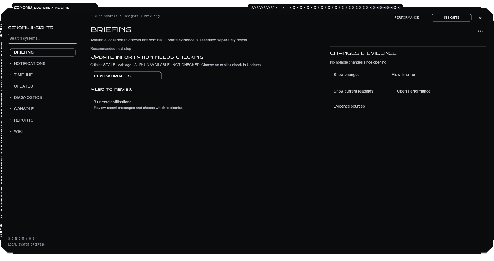

**Authority:** the owner's [14 November brief](../../PROJECT_STATE.md) explicitly rejects the visually underdeveloped composition. This is scoped rejection, not a retraction of data-safety/precision fixes, authored identity or the approved Control Overview. The image is a native same-provider baseline, not the owner's screenshot or a fresh live-session capture.

- **Proportion/hierarchy:** a large update-attention heading and generic Review action dominate nominal health. Unread messages become ordinary supporting text; the two-column split leaves an under-organized reading field.
- **Rhythm/framing:** correcting padding and sharing a perimeter does not give the controls a coherent anatomy. A persistent current route painted with the same outline as an action looks like a placeholder button.
- **Typography/density:** the custom font and border cannot carry the entire quality claim. The interface needs clear assessment, evidence uncertainty, actionable attention and supporting diagnostics even without those identity features.
- **Interaction:** stale source checks are an evidence gap, not proof of old installed packages. Navigation should reveal a destination without running checks. Preserve guards, private exports and current route ownership.

**Correction to explore:** information-led diagnostic regions and a prioritized attention queue; compare against a domain matrix. Treat current-page position and transient keyboard/hover as different states. Actual native alternatives and the selected implementation are documented in [the composition review](../../PROJECT_STATE.md). The original selection was agent evaluation under the owner's delegated assignment; the owner subsequently authorized its publication. That does not establish whole-interface or hardware acceptance.

## P03 — Owner-approved Audio Island, 15 November 2026

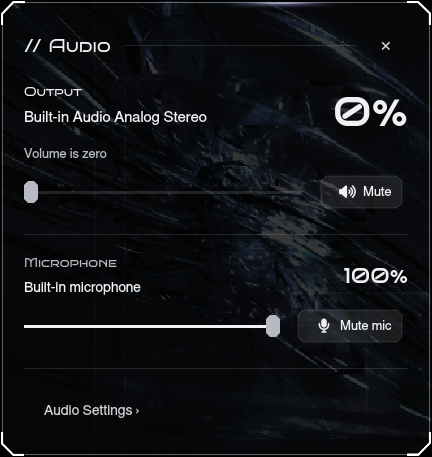

**Authority:** the owner explicitly said “apply” after the same-scale native Audio
comparison. This approves this Audio composition and its existing Lens material;
it does not approve every historical P01 screenshot or migrate all popups.

Output gain leads with a larger value; microphone gain is subordinate. Device names
wrap within their column. The shared IslandPopupFrame preserves authored corners
and clips both artwork and fill. Mute is a shaped, labelled icon control with an
amber muted state; zero volume is explained separately and muting retains gain.
Current devices use quiet fill, while hover and keyboard focus remain distinct.
Device changes retain reviewed apply/cancel and observed completion.

The normal candidate is 432px high versus the 399px baseline; the pictured 0%
state adds an explanatory line. At short work areas the body scrolls and keyboard
focus reveals controls. Larger text/high contrast and unavailable states were
inspected. The translucent artwork can admit competing background content; high
contrast retains an opaque alternative. It is not universal contrast certification.

**Evidence:** this image is an exact copy of the private publication fixture, with
fake 0% output / 100% microphone. Native pointer/keyboard and guarded device tests
passed for Audio and the shared-frame Lens. A separate live Audio render was
inspected after watched-source reload; volume, mute, endpoints, shell process and
existing application windows were preserved. Hardware routing and physical touch
remain separately unverified. Current behavior is owned by DESIGN_SYSTEM.

### P03 refinement — equal controls and inline media

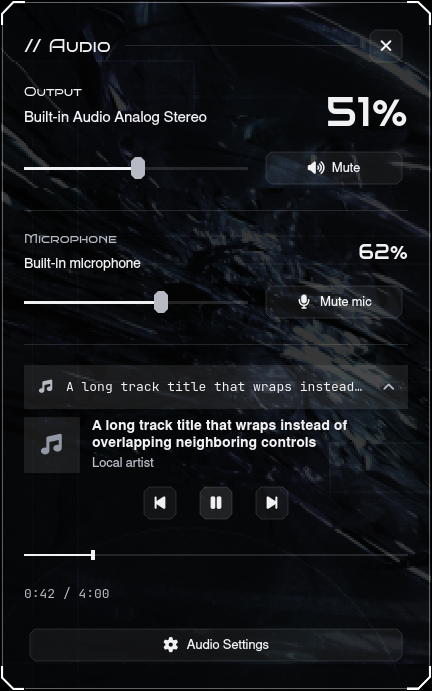

The owner subsequently requested removal of the hover effect, equal button
geometry, a better Settings action and an old-MP3-style track strip that expands
inside Audio. This refines the scoped P03 decisions; it does not retroactively
reject the original authored frame or approve unrelated panels.

The mute pair reserves its longest label width and retains a shared target height.
Pointer entry does not repaint sliders or mute buttons; keyboard focus remains
visible. Footer actions and device confirmation use the same quiet button style.
The track strip is a single disclosure, followed by cover/title/artist, equal
previous/play/next controls and capability-gated seeking. No player produces an
explicit empty state and disabled transports. Nothing auto-plays on opening.

Long track text moves left/right with end pauses only while visible and playing,
pauses for pointer/keyboard inspection, and stops when paused, hidden, clipped or
reduced motion is enabled. Expanded text wraps. A seek captures player/track identity
and is rejected if either changes during a drag. Existing MediaService and device
review controllers remain authoritative.

Fake-provider native captures establish disclosure, transport forwarding, seeking
capabilities/stale-drag guards, lost player, motion states, matched geometry and
short/touch/large-type behavior. Pixel comparisons of the control area before and
after pointer entry found zero differing pixels. The live no-player panel was
inspected without changing playback, volume, mute or endpoints. The pictured
media is fixture data; real-player and physical hardware acceptance remain scoped.

## P04 — Owner-approved connection-first Network popup, 15 November

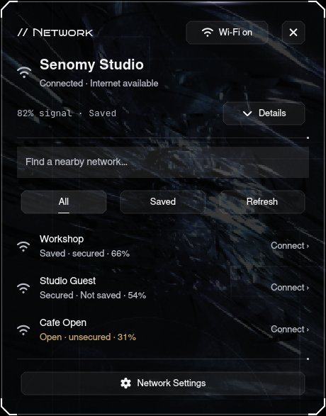

**Authority:** the owner requested publication after the native same-scale
comparison. Scope is this Network composition and the existing shared Island
material/quiet controls, not all Settings or Bluetooth rows.

Connection name and observed internet status lead. Signal percentage becomes
metadata. Details discloses interface/security and Disconnect. Name and All/Saved
filters operate locally on nearby choices; Refresh remains explicit. Whole-row
network targets retain exact identity and secured/saved/open labels. Captive
portal, unverified internet, radio off, hardware block and provider loss have
distinct states; browser handoff does not claim successful sign-in.

The normal fixture is 460×586 versus 460×558 baseline. Larger-text details and
filters reflow instead of overlap/truncate. At narrow/short bounds the body
scrolls, with focused search/filter controls wholly visible and Settings/Close
reachable. Current transparent material can admit underlying content; high
contrast supplies the opaque alternative. No decorative scanning indicator.

Shared QuietButton preserves the approved Audio behavior. Popup-specific
NetworkQuickChoiceRow and NetworkQuickActionReview avoid the full Settings and
Bluetooth contracts. An initial row-name collision blocked reload; Quickshell
kept the previous configuration. The original shared row/review were restored
byte-for-byte, distinct popup names supplied, and successful full reload plus
the actual new live popup were verified before completion.

**Evidence:** pictured names/strengths are fake native fixture data. Network and
Audio/media suites passed; a separate private live capture was inspected. Radio,
SSID, primary interface, Audio state, app windows, shell process and restart
counter were preserved. Real device/authentication/portal and physical touch
acceptance remain separate.

## P05 — Owner-approved charge-first Battery popup, 15 November

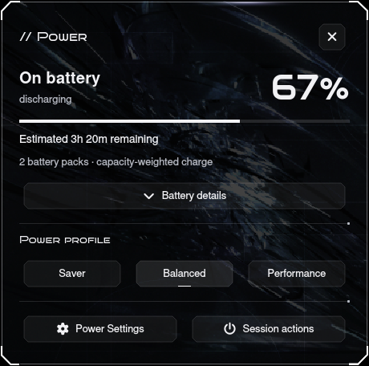

**Authority:** the owner said “apply the changes” after reviewing the native
before/after proposal. Scope is this Battery composition, Island material and
quiet controls. The expanded Senomy reference remains unchanged.

Charge and source/state lead, followed by a labelled provider estimate. One slim
bar reinforces the value; no equal-weight aggregate/time cards. Battery details
disclose per-pack percentage, model, state, energy and reported rate without
assigning fixed internal/removable identities. Health/threshold editing stays in
Settings. The two-pack figure is capacity weighted, not a mean of percentages.
Missing estimates remain unavailable, unknown charge is a dash, and no battery
hides the charge readout while independently available profiles remain usable.

At normal text the published fake two-pack composition is 460×456 versus the old 460×590.
Audiowide values, short Bruno Ace headings, readable body copy, restrained rules
and equal profile/exit controls carry hierarchy within one authored perimeter.
QuietButton has no animated pointer-hover outline; keyboard focus stays visible.
Narrow/large-text controls reflow and the body scrolls with focused controls
revealed; Close and exits remain reachable. The current choice has fill plus an
underline. Low charge has semantic emphasis without blinking or automatic policy.

Profile confirmation and pending battery-care reviews retain the actual action
objects and native ConfirmationFocus. A distinct BatteryQuickProfileReview avoids
changing shared Settings contracts. Native Rail anchoring was restored before
publication. The final live view includes the provider's truthful explanation
when profile control is unavailable; battery reporting continues independently.

**Evidence:** exact fake-device native capture; actual BatteryService and
SelectionActions tested weighted aggregation, charge states, stale-provider
rejection, Cancel, a single confirmed fake write, routes and constrained focus.
Pending actual disabled-care state was reviewed/cancelled without helper writes.
Native production-type lint passed with existing unqualified-access warnings.
A private final live render was separately inspected; service/restart count,
app windows, two Rails, notifications and observed profile/thresholds preserved.
The IPC-opened popup was visible with internal focus, but native keyboardActive
was false; native keyboard/physical touch, profile switching and threshold
hardware acceptance are separate. Transparency can admit background text; the
existing opaque high-contrast alternative remains.

## P06 — Owner-approved unified application tray, 15 November

**Superseded composition:** P09 replaces the full-width app rows and per-app
descriptions with a compact icon/name grid. Native action and menu contracts remain.

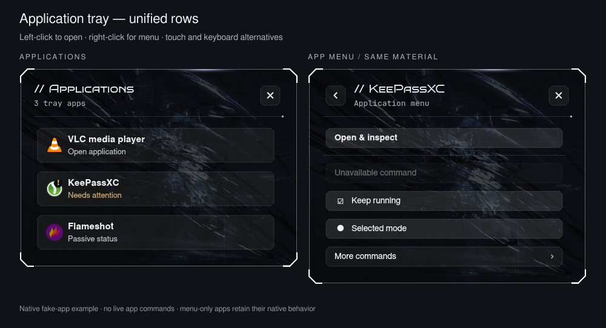

**Authority:** the owner refined the proposal to unify each app and its Menu
button, preserve left activation/right menu, and match every app menu's style;
then explicitly requested “apply”. This supersedes the split-button proposal
only. Compact Rail icons and the preserved expanded Senomy reference are unchanged.

One full-width row gives app names their reading space; native icon, title and
subordinate action/status carry hierarchy. Attention has text and a marker.
Registered-item count is not a task-manager/running-app claim. Right-click,
hold, Menu or Shift+F10 use the existing inline controller. Touch mode provides
an unframed ellipsis within the same row. Native only-menu items retain their
primary menu action; no executable is guessed from an app title.

Root and nested menus share IslandPopupFrame, the Bruno Ace heading, readable
command type and quiet controls. Checked/radio/disabled and submenu semantics
remain native; Back/Left/Escape retreat by one level and focus returns to the
originating app. Fixed scrollbar gutter removes the old width-feedback warning.
The list scales/scrolls for touch and narrow/large text without detached Menu
boxes. Pointer entry does not repaint; keyboard focus remains visible.

**Evidence:** same-scale fake native list/menu captures, not real app commands.
Native input, hold-without-activation, touch/keyboard/context routes, exact object
identity/removal, disabled/check states, deep menus and constrained focus passed.
Real private-D-Bus SystemTray/QsMenuOpener tests received primary, secondary,
wheel and third-level command events exactly once. Production native host compiled.
Final live two-app tray was separately opened/captured/inspected without invoking
any app or menu command. Source-watched reload preserved shell/restart count,
prior app windows, two Rails and notification owner. Real app-specific activation,
physical touch, screen-reader and fractional-scale acceptance remain separate.
Transparent material admits background text; high contrast stays opaque.

## P07 — Owner-approved month/day Calendar revamp, 15 November

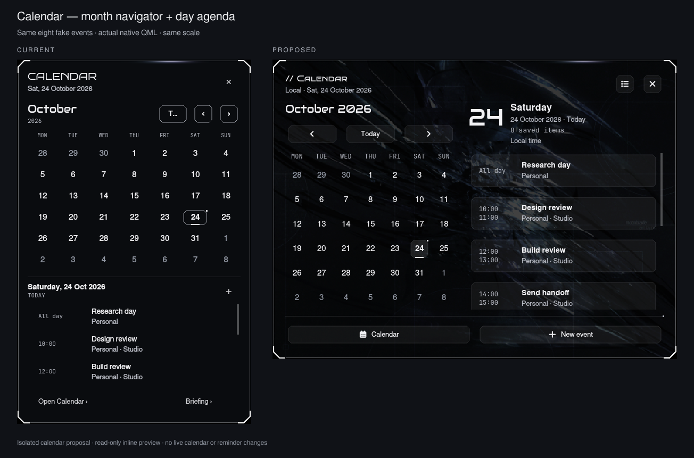

**Authority:** the owner explicitly requested a full popup UI revamp beyond a
reskin, reviewed the native comparison and said “yes apply that”. This approves
this composition/interaction scope, not a redesign of full Calendar or reminders.

A 760px popup uses simultaneous month navigation and selected-day reading panes
rather than a tall serial stack. The same eight fake events occupy 760×563 versus
440×685 before. Date, weekday, full date, count and display timezone identify the
agenda. All-day/timed/spanning semantics remain real provider data. Narrow layouts
lead with the agenda and disclose Choose date; focus and constrained scrolling
keep Close and primary Calendar/New event controls reachable. Briefing remains a
labelled header icon. Today, selection and keyboard focus are separate signals.

Event selection now opens a read-only inline preview; Open event explicitly
routes to the existing editor. Wrapped title/date/location and queued/conflict
context aid reading without introducing a second editor. Back/Escape close the
preview first; selection/entry/query invalidation clears stale content. One shared
Island frame, authored clipping/artwork, existing type roles and quiet controls
preserve identity. The opaque high-contrast alternative remains.

**Evidence:** baseline/candidate native fake-event input and civil-date suites,
preview routing/Escape/invalidation, timezone, narrow/touch/large-type behavior
passed. Actual CalendarService/Python daemon were tested on private socket/state,
including all-day/spanning/zoned events, source visibility and repeated openings.
Native production popup compiled. Final live empty-day popup was separately
opened/captured/inspected; no real event or reminder write/activation was sent.
Both shell/calendar service identities/restart counts, prior app windows, Rails
and notification owner stayed stable. The private fixture was corrected to track
concurrent replies by request identity. Live editor handoff, physical touch,
screen-reader and fractional-scale acceptance remain separate. Transparent
material admits background content; the capture is not universal contrast proof.

## P08 — Owner-approved notification inbox, 15 November

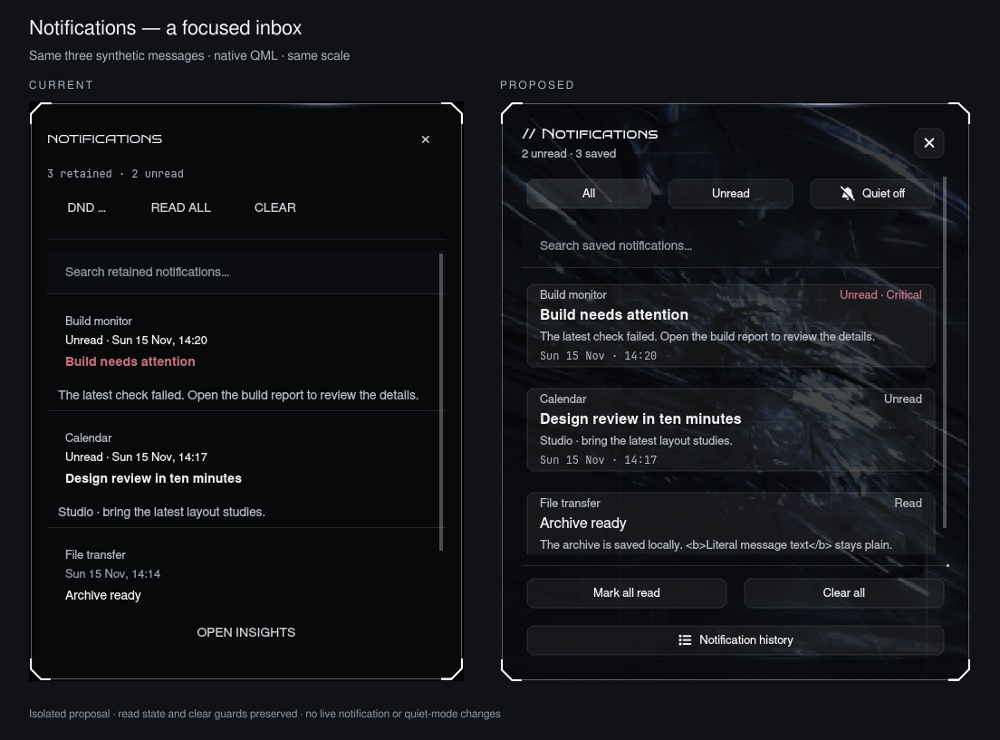

**Authority:** the owner reviewed the native proposal and explicitly requested
“apply notification proposed”. Scope is the quick inbox, not full Insights/toast
or notification policy. Its same three synthetic records use 520×641 versus the
480×640 baseline. App attribution and Read/Unread/Critical words accompany a
readable title/body preview and date/time inside each unified row.

All/Unread and local search do not read or delete data. Opening reads that exact
version only; the opened item remains pinned in Unread until closed, so reading
does not destroy its own context. Expanded plain-text details expose exact live
app actions; saved closed records cannot act. Replacement identity invalidates
selection and native action validation remains authoritative. Dismiss one, Mark
all read and Clear all are separate commands. The actual clear guard retains
owner/snapshot validation, safe Cancel focus and explicit irreversible impact.
Review controls stack for large/narrow text; history stays reachable. System
commitments remain separate from history and cannot be cleared as notifications.
Quiet on/off explains critical/transient suppression without claiming replay.

Shared Island material, authored clipping, existing type roles and quiet controls
match the accepted family. Narrow layouts wrap filters and grow actions; focused
controls remain revealed through long bodies/reviews. Source attribution is not
trust. The opaque high-contrast alternative remains; transparency can admit
unrelated content and is not universal contrast proof.

**Evidence:** native fake-record input/render suite and production host compile
passed without warnings. Real NotificationClearActions guard exercised read,
stale arrival, review/Cancel/Confirm/save and separate schedule semantics. Eleven
backend guard unit cases, original popup/Insights review UI and private-D-Bus
NotificationService protocol tests passed. Pointer captures were byte-identical.
A separate final live inbox was opened/captured/inspected without opening a
message. Owner, counts/read state/DND, service identities/restart counts, app
windows and both Rails were preserved. Real client actions/session mutations,
physical touch, screen-reader and fractional-scale acceptance remain separate.

## R05 — Power chooser: descriptive list rejected, 15 November

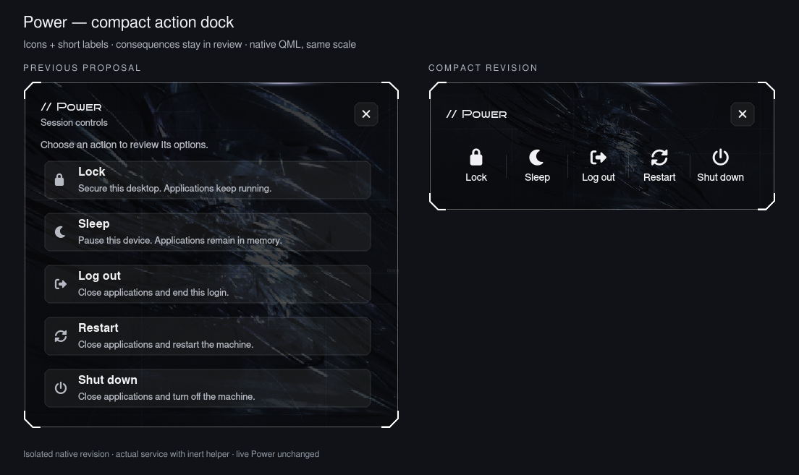

**Authority:** the owner rejected the left-side proposal as a list using too much
space, called its sub-descriptions unnecessary clutter, and requested a full
revamp. This rejects that chooser composition/prose only; the original authored
Island frame, scheduling/confirmation and other products’ lists are not rejected.

The left proposal is 520×481 with five rows repeating familiar action meanings.
The right is an implemented revision at 480×180: one compact icon/name
dock with fine separators. Redundant initial/options descriptions are removed;
consequences remain in prepared review. Narrow mode centers 3+2 targets; keyboard
arrows/Home/End move focus without action. Retain native confirmation and exact
schedule identity instead of compressing the flow into immediate execution.

Both images are isolated native fixture evidence. Revised native input and real
provider/inert-helper checks plus production-host compile passed; the revision
was subsequently accepted as a visual direction when the owner said “yes that works”
and requested the same treatment for the tray. A later explicit request applied
Power; see P10 for publication/live evidence. The comparison itself does not
establish hardware, physical input or native placement acceptance.

## P09 — Owner-approved compact application tray, 15 November

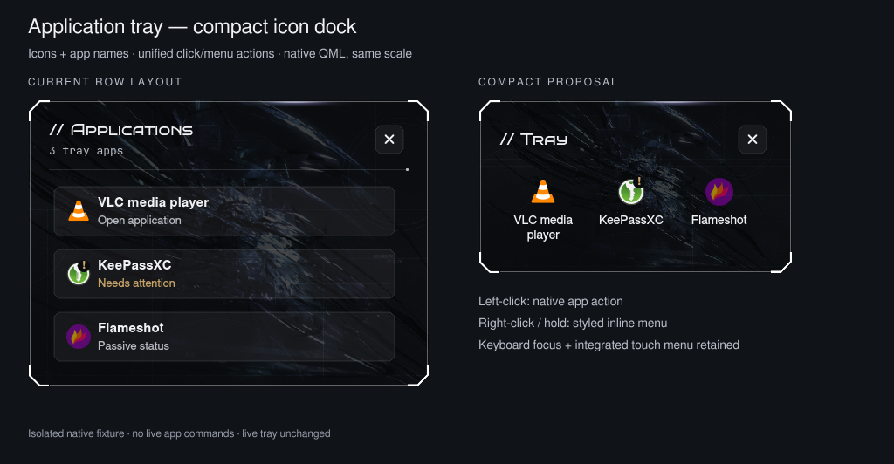

**Authority:** after accepting compact Power, the owner requested the same for
the tray, accepted its native comparison and explicitly said “perfect apply that”.
This supersedes P06's discovery-row composition, not its native action contracts.

At the same scale, the three-app chooser changes from 460×330 to 360×200:
icon → two-line app name, no description/count subtitle or resting app cards.
The frame/material and app icons retain identity; attention remains a marker and
accessible state. Columns shrink for fewer apps and wrap/scroll for more or larger
text. Focus follows grid geometry and remains visible after workarea resize.
Left activation, native menu-only primary, right menu, middle secondary, hold,
Menu/Shift+F10 and integrated touch menu stay intact. Icon wheel remains native;
caption wheel scrolls inventory. App command menus remain readable styled lists
with checked/disabled states, exact identities, ancestry and Back/Escape.

**Evidence:** actual offscreen native QML comparison and constrained states were
inspected. Native input/production host compile and private actual SNI/DBusMenu
checks passed, including exactly-once third-level command delivery. Settled
pointer/rest captures are byte-identical. After authorized publication, the actual
live two-app 256×200 tray was opened/captured/inspected without app commands and
its prior popup state restored. Processes/restart counts, prior app identities,
Rails/reserves and notification owner stayed unchanged. Physical touch, screen
reader, fractional scale and real app actions remain separately unaccepted.
Transparent material admits background text; high contrast stays opaque. The
comparison is stage evidence captured before publication, not a live app image.

## P10 — Owner-approved compact Power panel, 15 November

**Authority:** the owner accepted the compact direction, then explicitly requested
“apply the proposed for the power panel as well”. This replaces the previous
Power popup composition and supersedes the unpublished stage described in R05.

Five icons/short labels occupy a 480×180 chooser with the authored Island frame
and transparent material. Narrow layouts center three plus two equal targets.
Description rows and repeated options prose are removed; action selection opens
Now/Schedule options, and explicit prepared review retains consequences, timing,
replacement and authentication. Authoritative active/missed/failed/unverified
instructions retain monitor, edit, cancel, postpone and guarded Run now routes.
Quiet pointer feedback and shaped keyboard focus retain the accepted behavior.
The five popup-specific helper types avoid changing shared Calendar/Session fields.

**Evidence:** inspected actual native chooser/options/review, timer, narrow/touch
and large-text renders. The real unchanged PowerService with an inert helper
passed safe-choice, confirmation, scheduling/replacement/recovery/date-fold/focus
checks; native production host compiled. Quiet/settled image pairs are identical.
The prior 49 scheduler-unit results concern the unchanged engine and were not
rerun for this layout. Authorized publication added six runtime files and updated
the existing popup fixture. The actual live 480×180 chooser was captured/inspected
without actions or timers; Power state/schedule and ordinary popup state were
preserved. Processes/restarts, app identities, Rails/reserves, notification owner
and compact tray stayed unchanged. Real actions/authentication, hardware, physical
touch, screen reader and fractional-scale acceptance remain separate. The board
is isolated native stage evidence; transparent material admits background content.

## P11 — Owner-approved Insights workspace revamp, 15 November

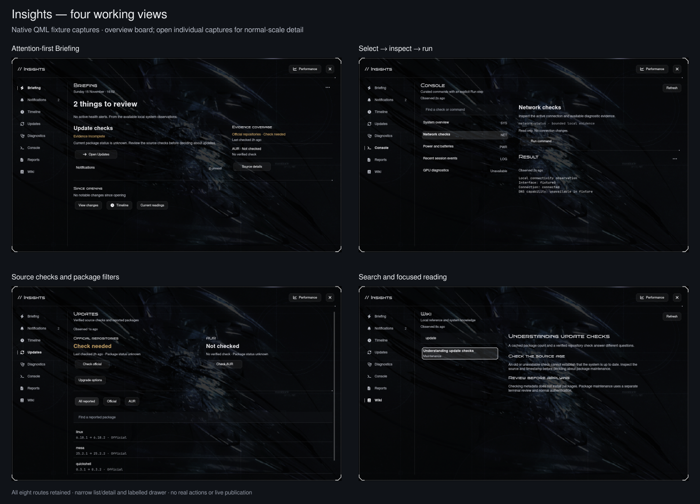

**Authority:** the owner requested a full Insights revamp using the supplied design
skills, reviewed the native proposal and explicitly said “apply the redesign”.
This supersedes the prior Insights directory composition, not Performance’s host,
provider/action ownership or the preserved expanded Senomy reference.

A single Island perimeter and compact icon/label sidebar retain all eight routes;
repeated surface labels and generic system-directory search are removed. Briefing
leads with observed attention and an explicit destination, separating local health
from update evidence uncertainty. Telemetry/opening deltas remain disclosed context.
Inbox reuses exact-version reads, Unread retention, live actions and real clear
review; its session commitment stays separate through quiet mode. Timeline/package
and Wiki queries are local. Update source checks and terminal handoff remain explicit;
source errors, warnings and sample limits stay truthful. Tasks select before Run,
show only their exact result, and bound long output in a keyboard-scrollable region.
Reports keep supported scopes, explicit generation/open and private exports. Wiki
uses readable prose and search; narrow workbenches/articles offer list/detail Back.
The drawer closes before body focus can be obscured. Existing type/material/motion
roles remain; no new palette, dependencies, service or sampler.

**Evidence:** actual native wide/narrow/large-type/high-contrast/touch, details,
empty/failed/unavailable states were inspected. The board shows four fixture views
at 0.52 scale, not a normal-size reading target or live machine data. Native
input/guard checks and 17 request-policy cases passed; the actual service adapter
passed with private helpers. Production native window compiled hidden on existing
Wayland, without a nested compositor. After authorized publication, all eight real
routes opened read-only; live Briefing/Console/Wiki were separately captured and
inspected. Services/restarts, prior app identities, Rails/reserves, notification
counts/quiet/owner and power state/schedule were preserved; prior visible primary/
popup state restored. No actions or notification records were invoked. The broader
Performance process-row keyboard assertion also fails on the unchanged baseline;
it remains recorded, not hidden by modifying Performance. Real action/provider,
physical touch, screen-reader, fractional-scale and broad hardware acceptance remain
separate. Transparent material still admits background content; high contrast uses
the existing opaque alternative.

## P12 — Performance workspace with retained searchable tree, 15 November

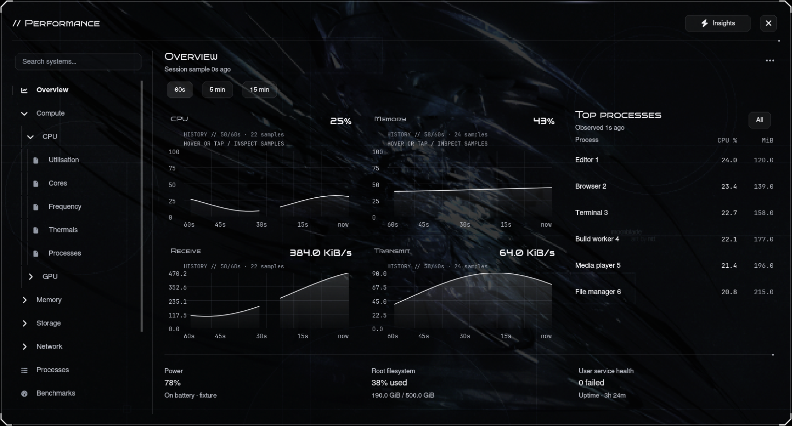
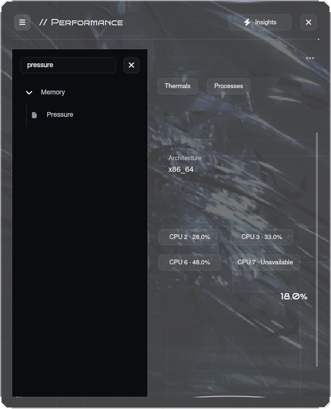

**Authority:** the owner said “apply” to the native Performance redesign, then
explicitly requested keeping the file-tree directory and search bar while improving
their design. This supersedes the proposal’s flat sidebar, not the new resource
content. It is scoped user direction, not blanket acceptance of every pixel or device.

One authored Island perimeter retains the established artwork/transparency/type
roles. A scaled 260px tree column uses quiet rows, branch guides and a persistent
location marker. Search reveals matching leaves with ancestors; disclosure remains
separate from route activation. Direct leaves and local tabs select the same exact
view. Query/expansion survive sidebar/drawer changes. Arrow/Home/End, search Down/
Escape and explicit clear remain available; branch toggling restores row identity.
Overview compares CPU/memory histories with top processes; secondary traffic and
power/storage/service context stay unboxed. Process rows are virtualized and roving;
identity/Back and reviews remain reachable in narrow inspection. Familiar actions
precede disclosed command/path details. Tasks, service and workload selection remain
inert until their explicit guarded action. Unknowns/gaps and unsupported GPU/DNS/SMART
stay truthful; no new sampler, palette, provider or action protocol.

**Evidence:** exact native fixture captures above at original 1560×840 and 680×840,
synthetic observations, no real machine/private log content. Full route/resource,
search/tree, branch-focus, tab/leaf identity, narrow/large-type and guarded-action
checks passed with inert transports. Combined Insights/Performance checks and all
17 request-policy cases pass. Production window compiled hidden on existing Wayland;
14 service/data QML cases pass. Real procfs continuity was checked read-only. All
12 live routes subsequently opened read-only; live Overview/CPU/Processes were
inspected. Native work-area geometry and two Rails were checked; app/service/
notification/power state preserved. An unloaded CPU inventory label was corrected
and missing-inventory coverage added. A separate stale-sort response race is fixed
with generation/serialization checks. The historical Tab-per-row assertion was
incorrect for a roving list; baseline arrows reach all 36 fixture rows. Real signal,
restart, workload, physical input, screen-reader and broad hardware acceptance remain
separate. This does not change approved Insights or the generic DirectoryNavigation.

## P13 — Owner-approved Control Centre workspace, 15 November

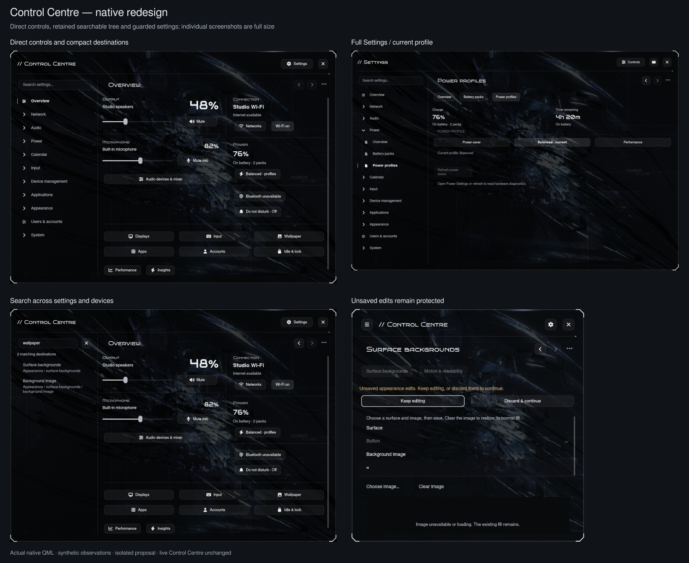
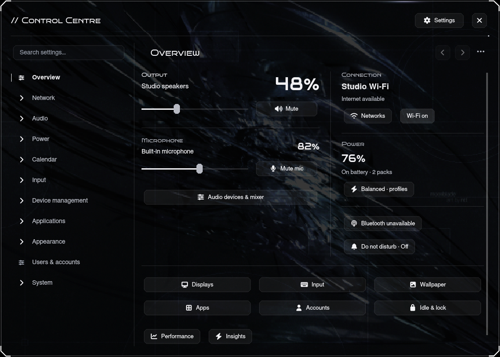

**Authority:** the owner requested a full Control Centre revamp after the Island
panels and retained searchable Performance tree, reviewed the native proposal,
then explicitly said “apply”. This supersedes A06’s indirect split composition,
not the shared workspace, route/provider/action or native Settings contracts.

One Island perimeter removes repeated surface labels and the second glass outline.
Direct output/microphone controls share space with observed connection/power state;
DND names On/Off, unsupported profiles stay disabled and current profile is distinct.
No-player media is omitted; a real selected player uses the existing inline media
component. The shortcut dock uses three columns at wide widths and reflows without
shrinking text. Operational controls precede optional telemetry and primary exits.
The searchable hierarchy persists in compact/full modes, preserving synonym ranking,
dynamic identities and exact destination focus. Local subviews reduce repeated route
lists. Scoped command styling keeps forms/actions in their owners. Narrow layouts
retain a labelled drawer; body focus closes an obstruction, bottom controls scroll
into view, and dirty review keeps both choices reachable. Existing type/scale,
touch, contrast and reduced-motion roles remain; no new packages, artwork or sampler.

**Evidence:** actual native synthetic matrix at wide/full/narrow/large text/touch,
focused search and controls, scrolled lower overview, supported/unsupported profiles,
DND On/Off and real unsaved-edit review. The board embeds staged native captures at
reduced scale; open individual sources for reading detail. Independent review scored
five identified fixes resolved, a bounded verdict rather than blanket approval.
Twenty-four coordinator cases, all nested routes/search/portrait focus/dynamic paths,
dirty/modal no-mutation and three close/geometry checks passed. Hidden production
hosts compiled on existing Wayland without a nested compositor. The published
quality runner passed. A first hot reload rejected a newly introduced local inline
type and retained the old config; replacing local aliases with equivalent standard
Text/Rectangle declarations loaded successfully without restarting the shell. The
second image records that tested equivalent actual QML, with synthetic observations.
Afterward eleven live sections opened read-only; compact Overview/Power and full
native Settings were captured and inspected, including the compact/full round trip.
Prior visible state, app identities, shell/calendar processes and restart counts,
Rails/reserves, notification owner/state, audio settings, radio/connection and power
schedule/policy were preserved. No new QML errors after correction. Real device/
authentication actions, physical input, screen-reader and broad hardware acceptance
remain separate. Busy-background transparency retains the existing opaque high-
contrast alternative. Providers, Performance and Insights sources remain unchanged.

## P14 — Remaining Island panels; companion removed, 15 November

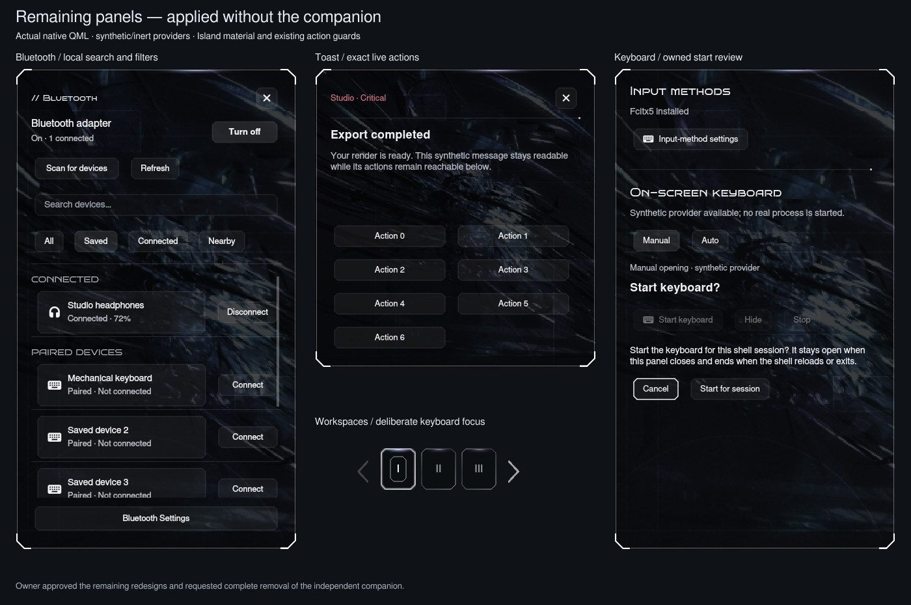

**Authority:** after the staged native proposal, the owner said “ok apply all of
them but delete the companion entirely its a redundant function”. This accepts the
remaining-panel direction and explicitly removes the independent companion feature;
it does not accept its staged redesign. Original expanded Island composition/art,
Insights and the other approved primary surfaces remain.

Bluetooth puts adapter/connection first, separates explicit scan from local query
and All/Saved/Connected/Nearby filters, and opens exact-device details inline with
Back. Toast summary/body and exact live actions have separate bounded scrolling;
a commitment warning uses opaque material with pinned Cancel/Open session. Hide
never reads or dismisses history. Input/OSK shows observed ownership and visibility,
separates Manual/Auto, and retains the actual controller's reviewed start/stop.
Deeper mixer, account and display editors organize direction/search/grouping,
profile drafts and layout/recovery actions with the same quiet, measured controls.
Readable scoped fields resolve the earlier clipping. Workspace keyboard navigation
reveals overflow without activation; Enter activates the exact focused identity.
These are task-specific interiors inside the incumbent artwork/chamfer/transparency,
not another palette, frame system or set of providers. ScheduleRail is retained.

The companion window, state/IPC, dead entry signals, duplicate media helper,
unneeded avatar decode contexts and current help entries are removed. Authored
source art and historical evidence remain historical, not active product surfaces.
Its prior staged pin/dock/media composition is excluded from this approval.

**Evidence:** the board embeds actual native QML captures after companion removal,
with synthetic observations and inert transports. The two-phase panel/editor runner,
current Control Centre quality, eight screen-lifecycle cases, Rail/popup interaction,
anchors, full-shell lint and hidden native Rail/popup compilation pass. Targeted
private provider suites from the reviewed proposal cover Bluetooth, account, display,
audio and OSK action boundaries. The older route-test host fails the same overview
focus check on the unchanged baseline and candidate; it is not passing evidence.
Live Bluetooth and six Settings routes were opened read-only and actual captures
inspected; full Settings plus Performance/Insights coordination also passed. The
same shell/calendar processes/restart counts, prior app identities, Rails/reserves,
notifications/owner, device/settings and display transaction/draft were preserved.
No new QML errors; expected deletion-scanner and incumbent hot-reload/optional-file
warnings are in the receipt. No real device/authentication/session action or physical
input acceptance is claimed. The tracked unused companion compositor match was
removed; live compositor configuration was not synchronized or reloaded.

## P15 — Existing Island material across the compact Rail, 15 November

**Authority:** owner requested background on the entire bottom island set, including
collapsed Senomy, following the panel redesigns. This approves that specific material
extension; it does not redesign the expanded Island, compact composition or feedback.

Workspace cells, collapsed/message Senomy, controls, clock/bell and Power reuse the
existing expanded background role, image/scrim opacity and aspect-preserving crop.
The fill follows each existing seven-pixel compact chamfer and leaves the gaps fully
transparent. No enclosing full-width slab is introduced. Silver strokes/reflections
stay in place; opt-in compact consumers disable only the prior solid/interior fill.
A shared passive Canvas owns no input, timer or provider. Existing per-role image
overrides precede the shared image; high contrast is opaque and absent-image fallback
is dark. Source artwork, 72px reserve, target allocation, popup anchors, state/feedback
and expanded-panel composition remain unchanged.

**Evidence:** the exact live 1920×72 Rail was inspected on both current outputs.
Native before/after captures include full/narrow collapsed and message states,
compact/micro controls, scheduled Power and high-contrast/touch. Alpha probes confirm
transparent cut corners, translucent artwork and opaque high-contrast centres.
Original keyboard actions dispatch once; live data updates retain popup anchors.
Eight screen-lifecycle cases and existing Rail/popup interaction pass; eight changed
QML files lint cleanly. Same shell/calendar processes/restarts, app identities, both
Rails/reserves, notification state/owner and device settings were preserved. Closed
surfaces are restored; reload-reset last Settings route was restored read-only.
No new QML errors; incumbent stack-order and optional-file warnings remain. The image
shows current live observations, not fabricated telemetry. Physical input, fractional
scale and broad hardware acceptance remain separate. No packages or new artwork.

## P16 — Authentication Island without chibi

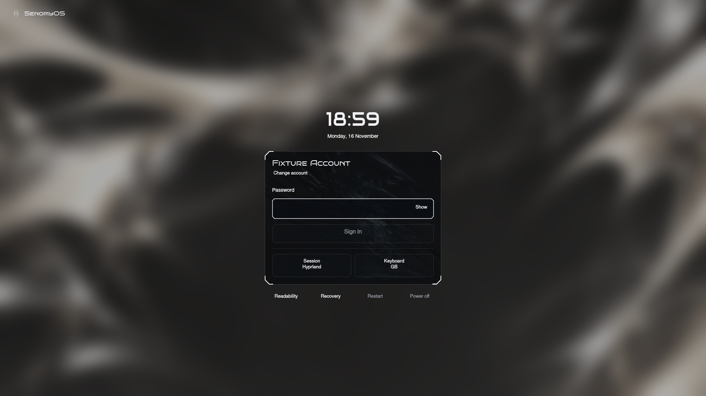

[Native narrow login](evidence/auth-login-narrow-20261116.png) ·
[Offline lock projection](evidence/auth-lock-projection-20261116.png)

**Authority:** on 16 November 2026 the owner said the result works and requested
application with the Senomy chibi removed. This approves the direction and omission;
it does not certify native authentication or the lock protocol.

**Proportion/hierarchy:** one 480px maximum credential Island, a full-width account
heading, password field and distinct Sign in action. Clock/date precede credentials;
quiet recovery, readability and guarded power follow. Narrow widths use available
space; short displays scroll the focused field and Show target into view.
**Rhythm/framing:** authored clipped corners surround the original Island material;
portrait removal leaves no reserved image column. The lock distributes identity,
password and keyboard context vertically inside its existing 320×460 frame.
**Typography/density:** existing heading/value/body roles keep credentials legible
without decorative metadata or duplicated character art.
**Interaction:** fake-proxy tests cover account search, session/layout selection,
credential clearing, pending dispatch and short-screen focus. The lock image is an
offline configuration projection. Installed source parity and transactional receipts
establish application; real PAM, session start and lock rendering remain separate.

**Transfer:** compact task hierarchy, authored materials, full-width identity and
bounded inline choices. **Exclude:** desktop character removal, automatic compositor
policy changes and treating fixture success as authentication/security acceptance.

## R06 — Owner-rejected Thunar appearance, 17 November

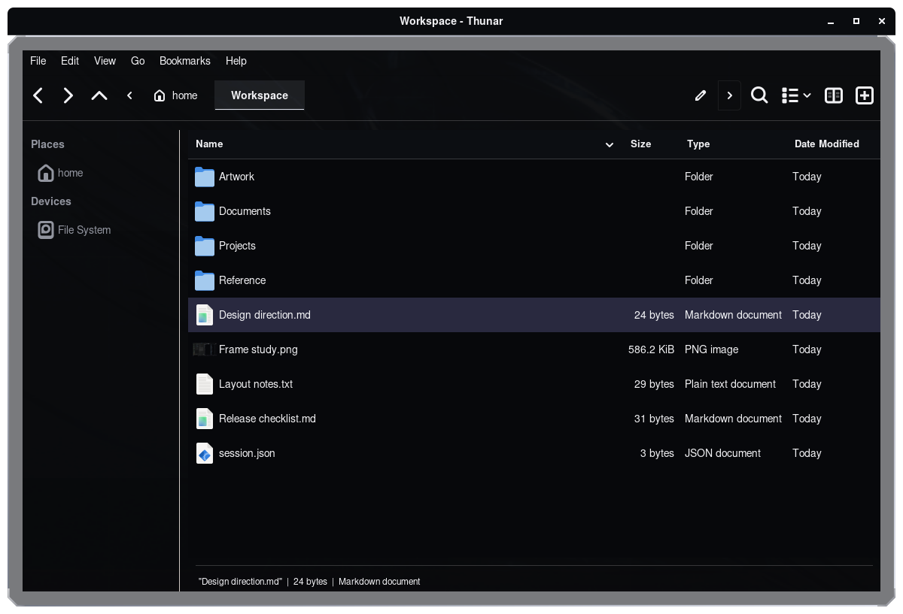

**Authority:** the owner supplied the installed workspace screenshot and said “looks
awful”. Prior reviewer ship and functional checks do not outrank this decision.
The parent inspected the attachment; the image here is a native public fixture of
the same appearance, not the owner's screenshot or private Home content.

**Failure:** a large perimeter carries most identity while the opaque file plane
buries the material. Oversized stock glyphs, blue folders and uniform chrome type
read as generic Thunar. The actual owner screenshot additionally shows duplicated
Home and very sparse Places. Empty sidebar area and repeated Type metadata weaken
filename hierarchy at the real roughly 935px client width. Native navigation and
file operations work, but that is separate from visual quality.

**Lesson:** rebuild the actual workspace hierarchy, scoped icons, native navigation
and material relationship; inspect the whole result at the owner's width. Do not
substitute a darker theme, a corner frame or a fixture-only header for complete
production integration. A rebuilt native prototype remains a proposal until its
owner accepts the visual direction and its integration is validated.

**Scope:** rejection of appearance only; preserve working actions, user data,
restore guards and the independent Thunar launch. The subsequent P17 rebuild
superseded this reskin, then received its own resize rejection described below.

## P17 — Owner-selected native Thunar composition, 17 November

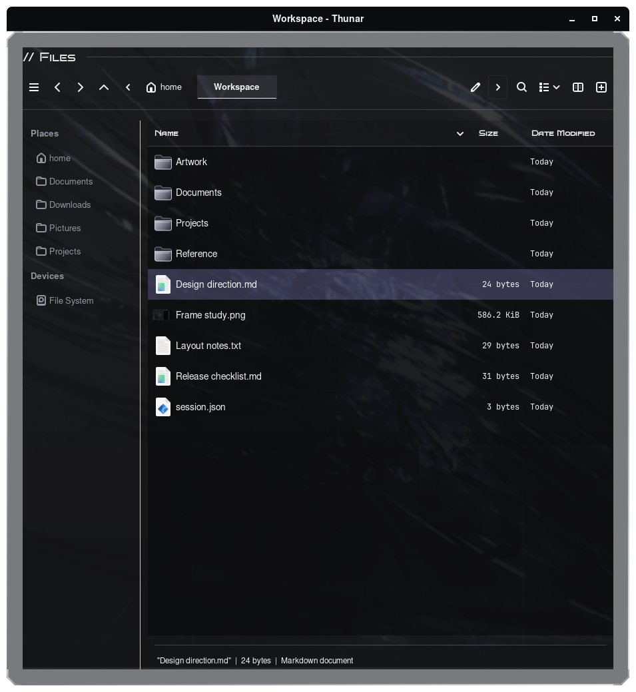

[Native split panes](evidence/thunar-native-split-20261117.png)

**Authority:** after rejecting the R06 installed appearance, the owner selected the
rebuilt native preview with “Closer—continue with this” and requested completion.
That selects this direction; it does not grant blanket final/hardware acceptance.
The owner subsequently rejected the installed result, especially resizing, then
rejected its next correction for unfilled side margins and an unconvincing overall
appearance at 1880×982. This case preserves the earlier selected direction only.
Neither prior review nor working resize assertions imply aesthetic acceptance.
The current reconstruction fills the original corner interiors and all gutters,
uses the other panels' cover/crop artwork over blackened backing, binds the heading
to the current folder, and bounds Name so metadata stays nearby. The native
retained-window matrix and independent review establish exercised quality, not
owner acceptance. The prior anchored-art/always-expanding-Name correction is
superseded; those implementation choices were never a separate owner decision.
The owner then explicitly requested semi-transparent Metalheart material and
restrained hover instead of white fills. This supersedes the reconstruction's
opaque ground: one native clipped translucent surface now spans the gutters,
with silver low-opacity states and distinct keyboard focus. The latest native
review and actual installed capture establish their tested scope, not blanket
owner aesthetic approval.

On the next assessment the owner rejected the theme-only iterations as too similar
and supplied a stronger sculpted chrome file-manager reference. That reference
now leads this surface's composition: substantial metal header/corners, dense
ruled table, steel location state and a dedicated real object inspector. The
native reconstruction passed independent review and the owner explicitly replied
“Apply this rebuild.” Application and actual installed Home inspection are recorded
in PROJECT_STATE and the private PUBLICATION.json. Earlier backdrop passes are not
visual acceptance of this structure; approval remains scoped to this application.

**Hierarchy/type:** an authored short Files cue and fine rule precede compact real
navigation. Names keep readable body type; size/date metadata uses the technical
role. The resize correction makes column headers readable sans while retaining the
short authored Files heading. Repetitive Type is omitted.
**Framing/material:** one original fixed-corner perimeter; intermediate native
panes remain transparent so the original directional artwork survives behind a
stronger file reading backing. There is no disconnected opaque slab or nested frame.
**Navigation/icons:** useful native Places, scoped existing silver folders, and real
search/view/split/tab controls preserve native overflow/keyboard behavior. Only
existing directories are added on the host; fixture Places are not a universal list.
**Implementation:** the production per-process GTK3 module owns header/icon/type
projection through native lifecycle events, not a screenshot injector. Thunar owns
files/providers/actions; the existing helper owns explicit layout/shared GTK Places
with exact private preimages and owner-edit-protected restore. Actual split/new-window/
remap state checks, source/build hashes and 49px native touch rows passed review.

R06 remains rejected history. Live Home evidence is private; these curated images
use actual native widgets with public fixture content. Physical touch, alternate
scale, screen readers and real file mutations remain separately unaccepted.
